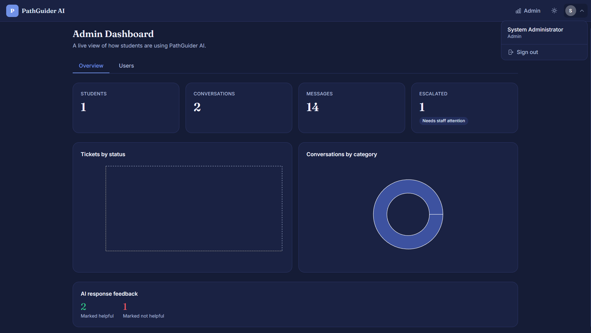

# 🎓 PathGuider AI

An AI-powered **Student Support Platform** developed using the **MERN Stack** and **Generative AI**. The application provides students with instant academic guidance, career assistance, campus support, personalized AI conversations, and secure authentication through a modern web interface.

-61DAFB)


---

## 📌 Features

* 🔐 Secure User Registration & Login
* 🤖 AI-Powered Student Assistant
* 💬 Real-Time AI Chat
* 📝 Personalized Chat History
* 🎓 Academic & Career Guidance
* 🏫 Campus Information Support
* 👨‍🏫 Counselor Connectivity
* 🔒 JWT Authentication & Password Encryption
* 📱 Fully Responsive Interface

---

## 🛠️ Technologies Used

### Frontend
* React (Vite)
* Tailwind CSS
* React Router
* Axios

### Backend
* Node.js
* Express.js
* MongoDB
* Mongoose
* JWT
* bcrypt.js

### AI Integration
* Grok API *(Supports OpenAI / Gemini / OpenRouter)*

### Tools
* VS Code
* Git
* GitHub
* Postman

---

## ⚙️ Prerequisites

* Node.js (v18 or above)
* MongoDB
* npm
* Git

---

## ▶️ How to Run

### Clone Repository

```bash
git clone https://github.com/rachit-bhardwaj/PathGuider-AI.git
cd PathGuider-AI
```

### Install Dependencies

Frontend

```bash
cd client
npm install
```

Backend

```bash
cd server
npm install
```

### Create Environment Variables

Create a `.env` file inside the server folder.

```env
PORT=5000
MONGO_URI=your_mongodb_connection_string
JWT_SECRET=your_secret_key

AI_API_KEY=your_api_key
AI_API_URL=your_ai_endpoint
```

### Start Backend

```bash
npm run dev
```

### Start Frontend

```bash
npm run dev
```

---

## 🗄️ Database

### Database

`PathGuiderAI`

Collections

* Users
* Chats
* Messages
* Counselors *(Optional)*

---

## 📂 Project Structure

### Frontend

* Authentication Pages
  * Login
  * Register
* AI Chat Interface
* Chat History

### Backend

* Authentication APIs
* AI Chat APIs
* User Management
* Chat History Management
* Middleware
* Database Models

---

## 🔐 Authentication

* JWT Authentication
* Password Hashing using bcrypt
* Protected Routes
* Secure API Access

---

## 📸 Project Screenshots

<table align="center">
<tr>
<td align="center">
<br>
<b>Home Page</b>
</td>

<td align="center">
<br>
<b>3 Simple Steps</b>
</td>
</tr>

<tr>
<td align="center">
<br>
<b>Counselor Profile</b>
</td>

<td align="center">
<br>
<b>Blog Section</b>
</td>
</tr>

<tr>
<td align="center">
<br>
<b>Registration Page</b>
</td>

<td align="center">
<br>
<b>User Book Appointment</b>
</td>
</tr>

<tr>
<td align="center">
<br>
<b>Chat with counselor</b>
</td>

<td align="center">
<br>
<b>Send Query to Counselor</b>
</td>
</tr>

<tr>
<td align="center">
<br>
<b>Counselor Profile</b>
</td>

<td align="center">
<br>
<b>Counselor Appointment List</b>
</td>
</tr>

<tr>
<td align="center">
<br>
<b>Counselor Time-Slots</b>
</td>

<td align="center">
<br>
<b>Admin Dashboard 1</b>
</td>
</tr>

<tr>
<td align="center">
<br>
<b>Admin Dashboard 2</b>
</td>

<td align="center">
<br>
<b>Admin Approve Counselor</b>
</td>
</tr>

</table>

---

## 🚀 Future Enhancements

* 🎙️ Voice-Based AI Assistant
* 🌍 Multilingual Support
* 📄 Resume & Document Analysis
* 📊 Student Analytics Dashboard
* ☁️ Cloud Deployment
* 📱 Android & iOS Applications
* 🧠 Retrieval-Augmented Generation (RAG)
* 🎯 Personalized Career Recommendations

---

## 👨‍💻 Developer

Built by **Rachit Bhardwaj**  
**Computer Science Engineering Student | Full-Stack MERN Developer**

---

## 📄 License

This project is developed for educational, research, and learning purposes.